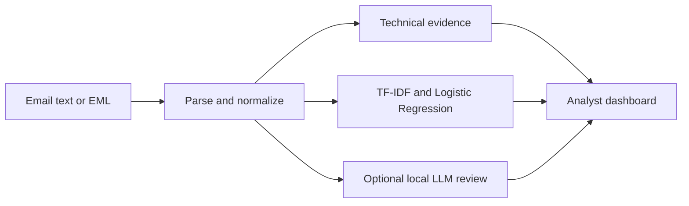

# AIC211 — Hybrid Phishing Email Analysis

A group academic project exploring how machine learning, email indicators, and a local language model can support a security analyst reviewing suspicious email.

**Public portfolio edition:** source code, synthetic examples, and an executable offline indicator demo. Real email corpora, trained models, local databases, and private research workspaces are not included.

## Start here

- Run the small [offline demo](#offline-demo-no-trained-model-required) to see structured email evidence.
- Read [`src/security_matrix.py`](src/security_matrix.py) for indicator extraction and missing-evidence handling.
- Read [`src/ml_detector.py`](src/ml_detector.py) and [`src/explainability.py`](src/explainability.py) for the TF-IDF/Logistic Regression implementation and feature contributions.
- Read [`app.py`](app.py) for the full Streamlit dashboard, or [`src/local_llm.py`](src/local_llm.py) for local-model integration.
- See [public export notes](docs/PUBLIC_EXPORT.md) for what was included and how to verify it.

## What the team built

| Component | Purpose |
| --- | --- |
| Email/MIME input | Accept pasted email text and uploaded `.eml` messages. |
| Technical evidence | Examine sender/Reply-To consistency, URL structure, social-engineering language, HTML, and attachment metadata. |
| ML classifier | TF-IDF features and Logistic Regression produce a model estimate. |
| Explainability | Display contributions from the linear classifier's features. |
| Local LLM integration | Request a separate structured semantic review through a local endpoint. |
| Analyst workflow | Present evidence and support controlled feedback/research-model evaluation. |



The offline demo below exercises the **technical-evidence branch only**. It does not load ML/LLM models or make a final phishing/legitimate classification.

## Offline demo: no trained model required

Use Python 3.12. The demo needs only NumPy; the full dashboard has a separate, larger dependency set.

### Windows PowerShell

```powershell
py -3.12 -m venv .venv
.\.venv\Scripts\python.exe -m pip install -r requirements-demo.txt
.\.venv\Scripts\python.exe tools/demo_indicators.py
.\.venv\Scripts\python.exe tools/demo_indicators.py examples/synthetic_benign.eml --json
.\.venv\Scripts\python.exe -m unittest discover -s tests_public -v
```

### Linux/macOS

```bash
python3.12 -m venv .venv
.venv/bin/python -m pip install -r requirements-demo.txt
.venv/bin/python tools/demo_indicators.py
.venv/bin/python -m unittest discover -s tests_public -v
```

The example messages are fabricated and use reserved example domains. The demo does not open links, contact a mail server, or execute attachments. Do not use these tiny fixtures as a training dataset or performance benchmark.

### Reading the output

| State | Meaning |
| --- | --- |
| `RISK` | An implemented rule observed an indicator worth reviewing. |
| `NO_INDICATOR` | That check did not observe its indicator; this is not a safety verdict. |
| `UNKNOWN` | Required evidence or a model result was not available. |
| `MODEL` | A supplied ML/LLM probability; the offline demo does not supply one. |

An untrusted `Authentication-Results: ... pass` header does not become verified authentication just because it appears in pasted email. In the standalone demo the authentication, ML, and LLM layers can correctly remain `UNKNOWN`.

## Full research dashboard

The original Streamlit application and research modules are included for source review. A fresh public clone **does not include a usable trained classifier**.

Full local inference additionally needs:

1. The Python 3.12 runtime dependencies in `requirements.lock`.
2. A compatible, trusted research bundle and portable `research_results/latest_benchmark.json` pointer, with its vectorizer, Logistic Regression model, summaries, metrics, and any manifest-referenced files.
3. A separately installed local LLM/runtime if semantic analysis is wanted.
4. Any optional language-model files and permitted research datasets required by the chosen workflow.

After those assets have been provisioned, `run.bat` → **T (Local Test)** supplies temporary local authentication and starts the loopback-only dashboard. Missing model assets remain unavailable; the application does not invent model predictions. The production path has additional authentication, integrity, and deployment gates.

[`docs/RESEARCH_WORKSPACE_README.md`](docs/RESEARCH_WORKSPACE_README.md) preserves the original workspace documentation for context; commands and paths there can depend on artifacts intentionally excluded here. [`RESEARCH_PROTOCOL.md`](RESEARCH_PROTOCOL.md) and [`config/research_datasets.json`](config/research_datasets.json) describe the research protocol and data provenance.

## Scope and limitations

- This is an academic research/portfolio project, not a deployed SOC product or mail gateway.
- External-dataset evaluation in the research workspace exposed generalization problems; the frozen research run was not approved for production deployment. No headline detection accuracy is claimed by this public edition.
- The application does not independently perform cryptographic DKIM verification or detonate attachments in a malware sandbox.
- An email's links, model estimates, and technical indicators require analyst interpretation. Missing evidence is not a benign finding.
- Full-workspace tests under `tests/` can require omitted datasets/models. Public CI runs only the documented synthetic-demo checks in `tests_public/` and syntax compilation.

## Authorship and attribution

This is an **AIC211 group academic project at FPT University**, presented by `callmewin06-create` as a portfolio copy of the team's work. Repository ownership does not imply sole authorship of the implementation. AI tools assisted parts of the project; individual contributions should be described separately in interviews and project reports.

No project-wide open-source license has been selected for this export. Dependency and dataset licenses remain separate; the dataset registry is metadata, not permission to redistribute every listed dataset.
